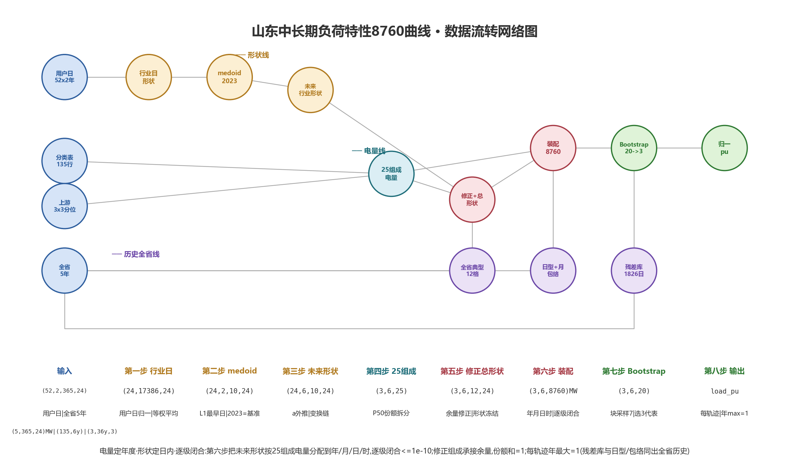

# 算法设计 · 数据维度流转

## 背景

本项目把山东省 1996—2025 年宏观序列、2020—2025 年行业年电量、2022/2023 两年 10 行业小时负荷，加工为 2030 年 10 行业 + 总负荷的 8760 小时曲线（MW 与标幺）。核心设计原则：**电量定幅值、历史定形状**——幅值线用 ARIMA+MLP 预测总电量并按占比拆分为行业电量锚点，形状线用周—日—小时三层从历史负荷提取标幺曲线，两线只在换算步汇合；总量不写死，每次运行按当次预测严格闭合。

## 流程图



列 = 操作层，节点 = 圆圈，连线 = 数据流；第一~三步幅值线（琥珀）、第五步形状线（紫）在第六步（红）汇合。

## 维度流转描述

每行 = `操作 → (变换后形状)`。步骤 1–3 幅值线（图·琥珀），步骤 4–5 形状线（图·紫），步骤 6 汇合（图·红）。

```text
输入
  宏观表     (30, 8)        30=1996–2025, 8=7特征+1总电量        111.xlsx 转置
  行业电量表 (6, 10)        6=2020–2025, 10=9重点行业+1总电量
  行业负荷   (10, 2, 8760)  10=行业, 2=2022/2023, 8760=小时       20个CSV堆叠
  config     目标年2030 · 节假日口径 · 各行业占比模型(线性/指数)

第一步 ARIMA 外推特征        (30, 8) → (5, 7)     模块02_
  7个特征列各自当时间序列外推5年，目的：造出2030年的输入特征：
  (30,) → ADF定差分阶d(≤2) → p,q∈0..3按AIC选阶 → ARIMA(p,d,q)
        → 预测1年接回序列重拟合，循环5轮 → 取2026–2030 → (5,)
  7列按列堆叠 → (5, 7)；电量列不外推（总量归第三步）

第二步 MLP 预测总电量        (30, 8)的样本 + (5, 7) → 标量        模块03_
  X (30,7)标准化(仅训练集拟合) / y (30,) 取电量列
  MLP(16,8) ReLU α=1e-3，5种子训练取平均；回测1996–2019训/2020–2025测
  全样本重训，输入2030特征 (1,7) → 2030总电量 标量(亿kWh)

第三步 行业电量 E            (6, 10) + 标量 → E (10,)            模块03_
  (6,10) → 9行业列÷总计列 → 占比 (6, 9)
  每列6点拟趋势(线性 share~year / 指数 ln(share)~year，config指定)，代入2030 → 占比 (9,)
  ×第二步总电量 → 重点行业电量 (9,)
  其他 = 总电量 − Σ9重点 → E (10,)，ΣE_i ≡ 总电量

第四步 历史负荷预处理        (10, 2, 8760) → (10, 2, 8760)       模块04_
  逐张校验8760点·时间连续·无重复/空值/Inf；零值不删不插，形状不变

第五步 周法标幺 s            (10, 2, 8760) → s (10, 8760)        模块05_
  每行业独立，(2,8760) 只留形状，丢掉量级，行业峰值=1：
  按日重排 (2,365,24) → 逐日max (2,365) → 分周 (2,52,7)
  三层模板：
    周峰   (52,)   各周峰/年峰 → 剔节假日周跨年平均 → 哪些周旺
    日峰   (52,7)  各日峰/该周最大日峰 → 一周里哪天高
    典型日 (52,24) 每周日峰最高日的24h/当日峰 → 一天里哪小时高
  2030逐小时 s = 周峰[w]×日峰[w,d]×小时[h] → (8760,) → /年max → s (10,8760)

第六步 换算与合成            E (10,) + s (10,8760) → 总负荷 (8760,)   模块06_
  K = E×100000/Σ_t s → (10,)     每行业一个放大系数，把峰值=1的形状放大成MW
  P = s×K → (10, 8760) MW        10条行业MW曲线，全年加总严格=E_i
  总负荷 = 10行逐小时相加 → (8760,) → /max → 标幺 (8760,)

总输出
  行业曲线 (10,8760)×2(MW/pu) + 总负荷 (8760,)×2(MW/pu)
```

形状主链：

```text
(30,8) →① (5,7) →② 标量 ─③→ E(10,) ─────────────┐
(6,10) →③ 占比(9,) ────────────────────────────────┼→⑥ P(10,8760) → 总 (8760,)
(10,2,8760) →④ (10,2,8760) →⑤ s(10,8760) ─────────┘
```

两条不变式：

- 幅值线与形状线只在 stage ⑥ 相交：E 决定幅值，s 决定形状，互不污染；
- ΣE_i = MLP预测总电量（其他行业取余额保证）、Σ_t P_i(t)/1e5 = E_i（K 定义保证）；
  每条标幺曲线 max=1；标幺不可直接相加（行业电量规模不同），必须 MW 求和后单独归一。

## 步骤与代码模块对应

| 步骤                | 模块                                                          |
| ------------------- | ------------------------------------------------------------- |
| 输入与配置          | 01_输入数据与配置/（config.json + 2 Excel + 20 CSV）          |
| 流程编排            | run_pipeline.py                                               |
| 第一步 ARIMA 外推   | 02_宏观特征预测/run_stage.py、arima_compat.py                 |
| 第二/三步 总电量与E | 03_总电量与行业电量预测/run_stage.py                          |
| 第四步 预处理       | 04_历史负荷预处理/run_stage.py                                |
| 第五步 周法标幺     | 05_行业标幺8760生成/weekly_generator.py、run_stage.py（批量） |
| 第六步 换算合成     | 06_有名值换算与总负荷合成/run_stage.py                        |
| 流程图脚本          | make_dim_flow_figure.py（生成 算法流程图.png）                |
